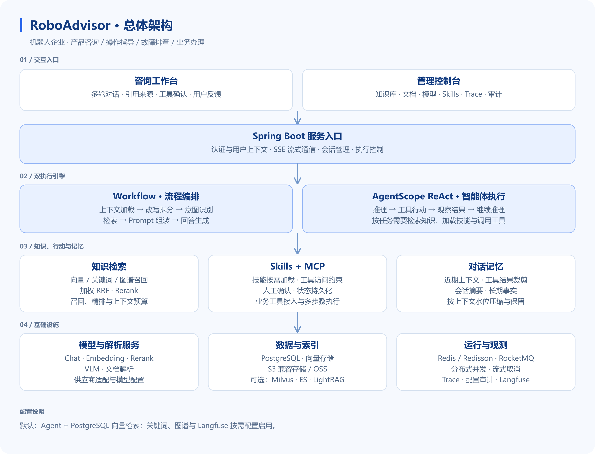
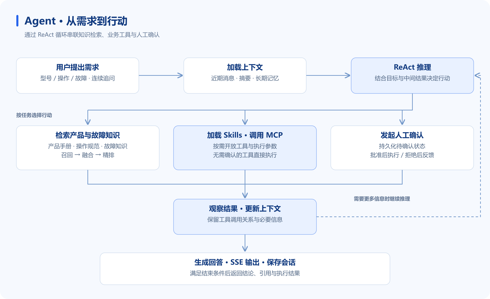
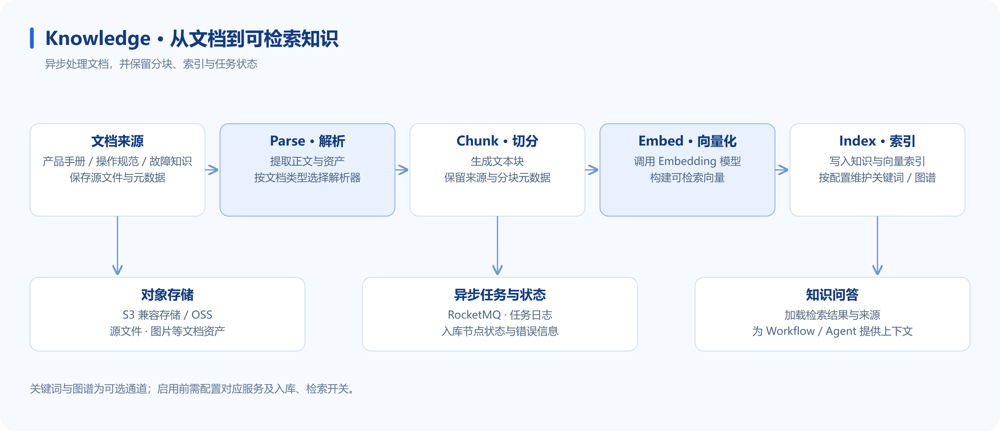

<div align="center">


# RoboAdvisor · 智机顾问

### 面向机器人企业的 Agentic RAG 智能助手平台

从产品咨询到故障排查，让机器人产品服务更高效。

产品咨询 · 操作指导 · 故障排查 · 业务办理

[GitHub](https://github.com/xmgbg/RoboAdvisor) · [快速开始](#快速开始) · [系统架构](#系统架构) · [核心能力](#核心能力) · [启动文档](启动.MD)


</div>

## 项目介绍

**智机顾问（RoboAdvisor）** 面向机器人企业产品咨询、操作指导、故障排查及业务办理场景，基于 **Spring Boot、React 与 AgentScope** 构建企业智能助手平台。通过接入产品手册、操作规范与故障知识，融合知识检索、智能体推理及业务工具调用，实现带来源引用的多轮问答与交互式任务办理，并提供知识库管理、执行过程展示及人工确认能力。

系统提供 **Workflow 与 ReAct 双执行模式**：既支持流程明确的知识问答，也支持需要反复检索、补充信息与调用工具的复杂需求。管理员通过控制台维护知识库、模型、技能与工具配置，并查看任务执行过程。

## 业务场景

| 场景 | 典型问题 | 助手如何参与 |
| --- | --- | --- |
| 产品咨询 | “这两款机器人有什么区别，分别适合什么场景？” | 检索产品规格与适用条件，结合多轮追问进行对比，并展示依据 |
| 操作指导 | “首次使用需要完成哪些配置？如何按规范启动？” | 根据对应型号的操作手册，查找配置要求、操作步骤与注意事项 |
| 故障排查 | “设备出现告警且无法启动，需要检查哪些项目？” | 澄清型号、告警信息与现象，检索故障知识，引导逐步排查 |
| 业务办理 | “帮我提交设备报修申请，并查询处理进度。” | 接入业务工具后，收集必要参数，对需要确认的操作发起确认并执行 |

产品问答与排查建议以实际导入的知识为依据；报修申请、工单查询等业务办理依赖实际接入的 MCP 工具与权限配置，仓库中的示例工具服务用于演示调用链路。

## 系统架构

### 总体架构



### Agent 执行流程



### 知识入库流程



## 核心能力

### 知识检索与回答证据

- **问题理解**：上下文改写、问题拆分、查询词映射与树形意图识别，按问题路由知识库。
- **混合检索**：支持向量、关键词、图谱通道，结合去重、加权 RRF 与 Rerank 组织检索结果。
- **上下文预算**：分别控制召回数量、精排候选与最终上下文，平衡检索覆盖与模型输入成本。
- **回答引用**：提供引用来源、原文预览、推荐追问与用户反馈入口。

### Agent 与业务工具

- **ReAct 执行循环**：依据中间结果继续检索、补充信息或调用工具，推进多步骤任务。
- **Skills 按需加载**：根据任务加载技能，并约束关联工具的可用范围。
- **MCP 工具接入**：统一连接外部能力，支持工具执行事件与结果展示。
- **人工确认与恢复**：对配置为需要确认的操作保存待确认状态，获得反馈后继续执行。

### 多轮记忆与执行控制

- **分层记忆**：工具结果裁剪、会话摘要与跨会话事实记忆共同管理上下文。
- **连续交互**：保留近期消息及必要的工具调用关系，为追问提供上下文。
- **任务控制**：分布式排队、并发管理、流式停止与跨节点取消。
- **可观测性**：执行时间线、工具状态、耗时、Trace 与配置变更审计。

### 知识维护与模型适配

- **文档入库**：解析、切分、向量化、索引持久化与任务状态管理。
- **知识维护**：知识库管理、分块管理、文档资产与远程来源刷新。
- **模型适配**：Chat、Embedding、Rerank、VLM 等模型客户端与供应商配置。
- **模型策略**：RAG 链路支持模型档位、候选路由与降级；Agent 主模型独立配置。

> 默认采用 Agent 模式与 PostgreSQL 向量检索。关键词、图谱、联网搜索及 Langfuse Trace 按需配置启用。

## 技术栈

| 层次 | 技术 |
| --- | --- |
| 前端交互 | React 18 · TypeScript · Vite · Tailwind CSS · Zustand |
| 应用服务 | Java 17 · Spring Boot 4.1 · MyBatis-Plus · Sa-Token |
| 智能体 | AgentScope · ReAct · Skills · MCP · HITL |
| 检索与数据 | PostgreSQL · 向量检索 · 加权 RRF · Rerank |
| 缓存与消息 | Redis · Redisson · RocketMQ |
| 文件与资产 | S3 兼容对象存储 · OSS |
| 可选扩展 | Milvus · Elasticsearch · LightRAG · Langfuse |

## 工程模块

| 模块 | 职责 |
| --- | --- |
| `bootstrap` | 应用启动、主配置与模块装配 |
| `agent` | ReAct 执行、Skills、记忆、人工确认与任务控制 |
| `rag` | 知识入库、检索、Workflow 问答与管理接口 |
| `infra-ai` | 模型客户端、供应商适配与路由 |
| `system` | 认证、用户与审计 |
| `framework` | SSE、上下文传递、幂等与公共基础设施 |
| `mcp-server` | 独立 MCP 示例工具服务 |
| `frontend` | 咨询工作台与管理控制台 |
| `resources` | 数据库脚本、容器配置与示例知识 |

## 快速开始

### 1. 准备环境

JDK 17、Node.js / npm、PostgreSQL、Redis、S3 兼容对象存储、RocketMQ，以及可用的模型服务。

默认模型配置使用 DeepSeek 进行 Agent 对话，百炼提供 Embedding、Rerank 等能力。数据库、Redis、对象存储及模型凭据通过运行环境提供，变量示例见 [.env.example](.env.example)。**Spring Boot 不会自动加载 `.env` 文件**，请在终端或 IDE 运行配置中设置环境变量。

### 2. 启动后端

完成基础服务、数据库初始化及环境变量配置后，在项目根目录执行：

```powershell
.\mvnw.cmd -DskipTests package
java -jar .\bootstrap\target\bootstrap-0.0.1-SNAPSHOT.jar
```

### 3. 启动前端

另开终端：

```powershell
cd frontend
# 首次运行时创建本地配置
Copy-Item .env.example .env
npm install
npm run dev
```

| 服务 | 默认地址 |
| --- | --- |
| 前端 | `http://127.0.0.1:5173` |
| 后端 API | `http://localhost:9090/api/ragent` |
| MCP 示例服务 | `http://localhost:9099` |

### 4. 体验知识问答

登录管理控制台，创建知识库并上传机器人产品手册、操作规范或故障知识，等待入库完成后在聊天页提问。需要体验业务工具时，按启动文档运行 MCP 示例服务；办理真实业务时，需接入对应的报修、工单等 MCP 服务。

部署前请设置独立凭据并完成访问控制与安全加固，相关说明见 [SECURITY.md](SECURITY.md)。
