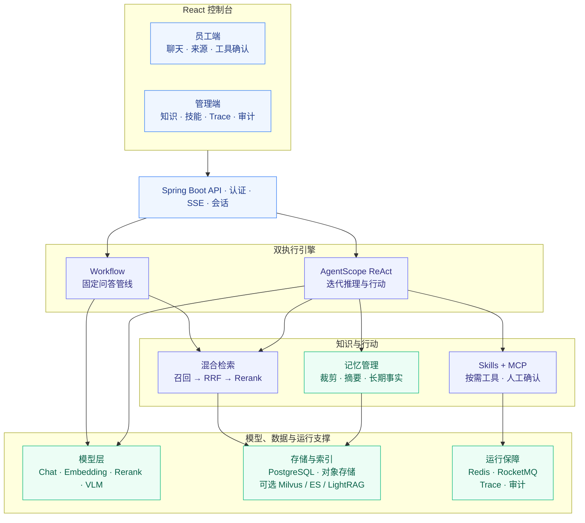
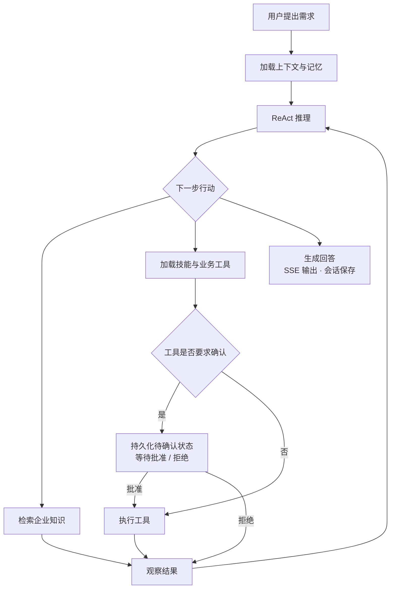
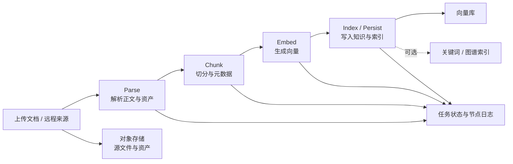
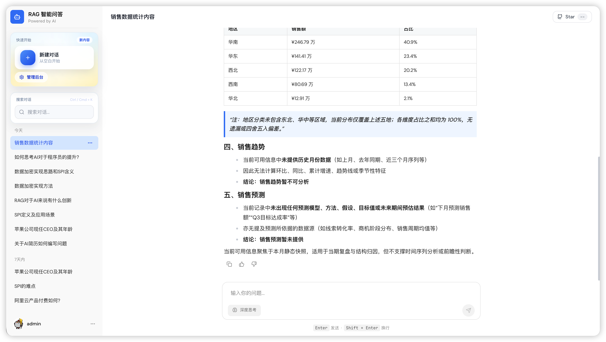
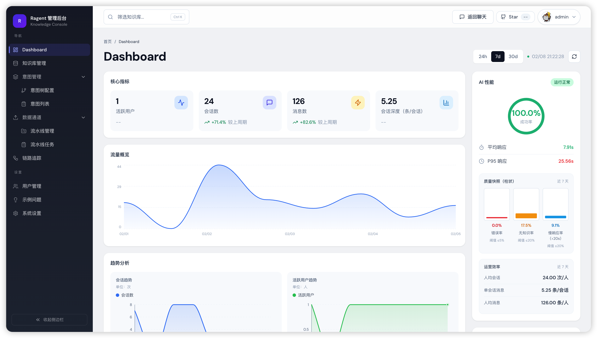

<div align="center">

# EnterpriseCopilot · 企智通

### 基于 Agentic RAG 的企业智能助手

企业知识问答 · 多步骤工具调用 · 可追踪的执行过程


</div>

EnterpriseCopilot 面向企业员工的内部知识咨询与业务办理，将知识库检索、多轮对话和工具调用纳入统一服务。管理员维护文档、技能和助手配置，员工通过自然语言查制度、问流程，并在接入相应业务工具后发起操作。

本仓库基于 [nageoffer/ragent](https://github.com/nageoffer/ragent) 进行品牌、配置隔离与发布文档调整，保留上游源码、版权声明和 Apache-2.0 许可证。核心引擎及工程能力来自上游；Java 包名、Maven 坐标和接口前缀沿用原项目。

## 业务场景

| 场景 | 交互示例 | 能力边界 |
| --- | --- | --- |
| 人事与行政咨询 | 请假规定是什么？会议室如何预约？ | 基于企业提供的制度与手册检索回答 |
| IT 支持 | 系统无法登录，应该如何排查？ | 结合操作手册多轮澄清，并展示来源 |
| 财务与流程查询 | 开票信息在哪里？报销需要哪些材料？ | 从对应知识库查找流程与说明 |
| 业务办理 | 帮我申请请假、预约会议室 | 需要配置业务工具；示例技能不等于真实企业系统接入 |

## 架构与执行链路

架构图使用 GitHub 可渲染的 Mermaid，源码随 README 一起维护。



### 从提问到执行



Workflow 模式按记忆加载、问题改写与拆分、意图识别、检索、Prompt 组装和生成顺序执行。Agent 模式将知识检索作为工具，在迭代次数约束内推进任务。人工确认应用于被配置为需要确认的工具调用。

### 从文档到知识



## 核心能力

| 能力 | 实现要点 |
| --- | --- |
| 问题理解 | 查询词映射、上下文改写、问题拆分、树形意图与知识库路由 |
| 混合检索 | 通道并行召回、去重、加权 RRF、Rerank；召回、精排和最终上下文预算分别控制 |
| 工具与技能 | MCP 工具接入、Skills 按需加载、工具执行事件与人工确认 |
| 对话记忆 | Workflow 近期消息与摘要；Agent 工具结果裁剪、摘要与长期事实记忆 |
| 知识维护 | 文档上传、入库 Pipeline、Chunk 管理与远程刷新 |
| 回答证据 | 来源与引用、原文预览、推荐追问、用户反馈 |
| 运行管理 | 分布式排队与并发控制、流式取消、Trace 和配置变更审计 |
| 模型接入 | RAG 模型档位、候选路由与降级；Agent 主模型独立配置 |

当前默认启用 Agent 模式、PostgreSQL 向量存储和向量检索。关键词、图谱、联网搜索及 Agent Langfuse Trace 默认关闭，启用前需配置对应依赖。Agent 主模型默认使用单模型，不能将 RAG 模型路由的降级能力视为 Agent 主模型的多供应商降级。

## 技术与模块

| 层次 | 技术 / 模块 |
| --- | --- |
| 前端 | React 18 · TypeScript · Vite · Tailwind CSS · Zustand |
| 应用 | Java 17 · Spring Boot 4.1 · AgentScope · MyBatis-Plus · Sa-Token |
| 数据与运行支撑 | PostgreSQL · Redis / Redisson · RocketMQ · S3 Compatible / OSS |
| 可选检索与观测 | Milvus · Elasticsearch · LightRAG · Langfuse |

```text
EnterpriseCopilot/
├── bootstrap/     启动与主配置
├── agent/         ReAct、Skills、记忆、确认与执行控制
├── rag/           知识入库、检索、Workflow 问答与管理接口
├── infra-ai/      模型客户端、路由与供应商适配
├── system/        认证、用户与审计
├── framework/     SSE、上下文、幂等与基础设施
├── mcp-server/    独立 MCP 示例工具服务
├── frontend/      员工端与管理控制台
└── resources/     数据库、容器配置与示例知识
```

## 控制台预览

下图来自上游仓库，展示继承的界面能力；截图中的 Ragent 标识尚未替换。

| 员工问答与来源 | 管理控制台 |
| --- | --- |
|  |  |

## 本地运行

完整环境清单和初始化顺序见 [启动.MD](启动.MD)。先准备 PostgreSQL、Redis、对象存储、RocketMQ 和模型密钥，再启动后端与前端。

```powershell
# 项目根目录；在该窗口设置模型服务环境变量后执行
.\mvnw.cmd -DskipTests package
java -jar .\bootstrap\target\bootstrap-0.0.1-SNAPSHOT.jar
```

另开终端启动前端：

```powershell
cd frontend
# 首次使用：将 .env.example 复制为 .env
npm install
npm run dev
```

前端：`http://127.0.0.1:5173`；后端接口前缀：`http://localhost:9090/api/ragent`。上述构建跳过测试，仅用于本地启动，不代表发布验收完成。

## 发布与安全


请勿提交真实 API Key、企业内部文档、用户数据、会话导出和本地凭据。安全反馈方式见 [SECURITY.md](SECURITY.md)。

## 来源与许可

本项目基于 [Ragent](https://github.com/nageoffer/ragent)，感谢原项目维护者及贡献者。本仓库采用独立发布历史，初始化与导入提交代表对上游代码的整理；原始作者及文件改动记录见 [八次改动记录](docs/git-soft-reset-20261013.md)，新旧提交对应关系见 [历史重建记录](docs/git-history-rebuild.md)。项目更名不改变原代码的贡献归属。

遵循 [Apache License 2.0](LICENSE)。
